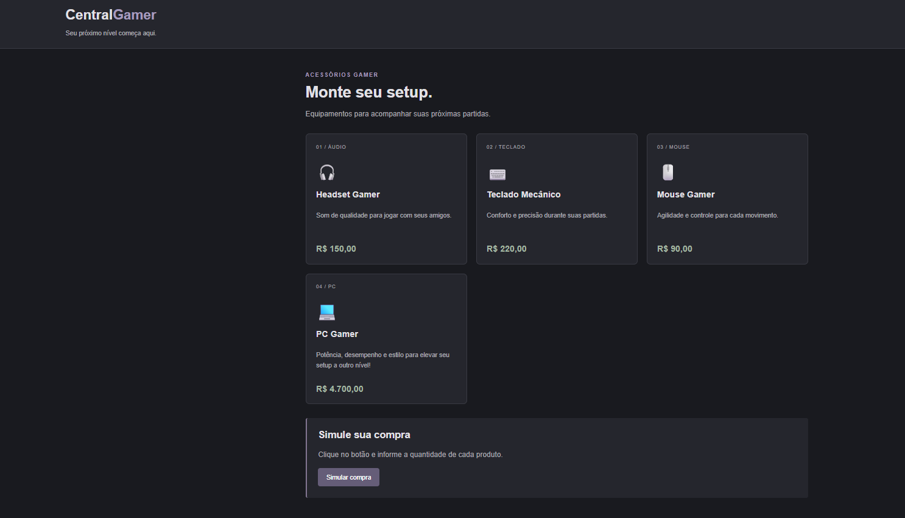
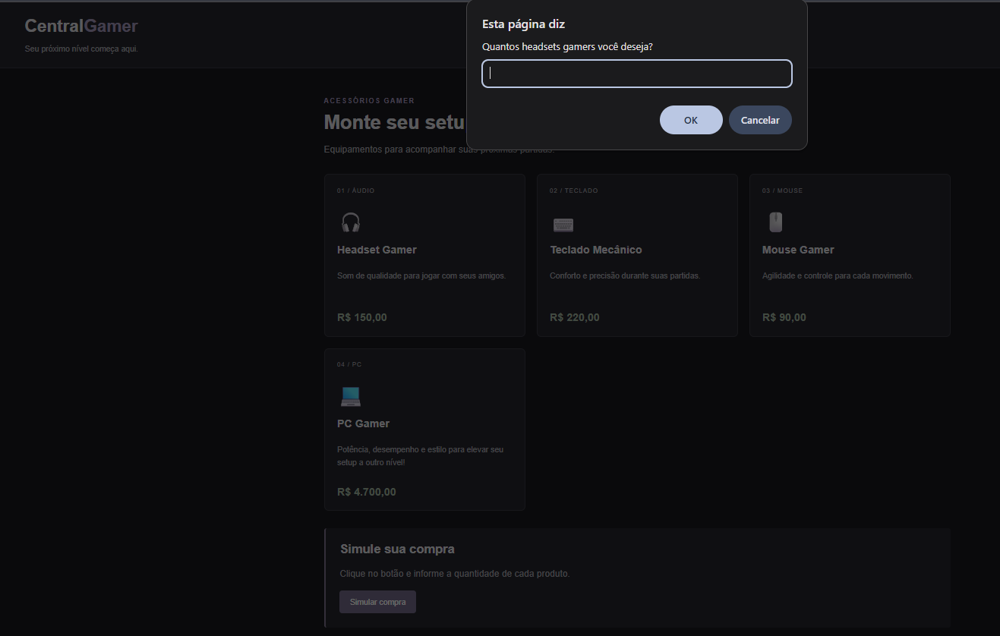

# Central Gamer

## Identificação

- **Aluna:** Thavynne Kialne da Luz Luzo
- **Trilha:** Desenvolvimento Mobile — Programa Trilhas

## Sobre o projeto

A Central Gamer é uma loja gamer fictícia desenvolvida para simular compras de produtos. A pessoa informa quantas unidades deseja comprar e recebe um resumo com os valores por produto e o total.

## Produtos e preços

- Headset Gamer — R$ 150,00
- Teclado Mecânico — R$ 220,00
- Mouse Gamer — R$ 90,00
- PC Gamer — R$ 4.700,00

## Tecnologias utilizadas

- HTML5
- CSS3
- JavaScript

## Como executar

1. Baixe ou clone o projeto e abra a pasta no computador.
2. Abra o arquivo `index.html` em um navegador.
3. Clique em **Simular compra**.
4. Informe a quantidade desejada para cada produto nas janelas que aparecerem.
5. Confira o resumo da compra exibido ao final.

## Como funciona a simulação

Ao clicar no botão, o JavaScript pergunta a quantidade de cada produto usando `prompt()`. As respostas são convertidas em números com `Number()`. Em seguida, o sistema multiplica cada quantidade pelo preço correspondente, soma os valores e apresenta com `alert()` as quantidades, os valores individuais e o total da compra.

## Validações

- Cada quantidade deve ser um número inteiro igual ou maior que zero. Valores inválidos, negativos ou fracionários exibem uma mensagem de orientação.
- Se a pessoa cancelar qualquer uma das perguntas, a simulação é interrompida e não é exibido o resumo.
- Se todas as quantidades forem zero, é exibida a mensagem: “Nenhum produto foi selecionado.”

## Casos Testados

1. **Quantidades válidas:** informar `2` headsets, `1` teclado, `1` mouse e `1` PC.
2. **Valor inválido:** informar uma quantidade negativa, fracionária ou texto que não represente um número inteiro.
3. **Cancelamento:** cancelar uma das janelas `prompt()` e verificar que a simulação é interrompida.
4. **Cálculo do total:** com as quantidades do primeiro caso, conferir os subtotais — R$ 300,00, R$ 220,00, R$ 90,00 e R$ 4.700,00 — e o total de **R$ 5.310,00**.
5. **Nenhum produto selecionado:** informar `0` para todos os produtos e verificar a mensagem apresentada.

## Dificuldades e aprendizados

Este projeto permite praticar a estrutura de uma página com HTML, personalizar seu visual com CSS e criar funcionalidades com JavaScript. tive oportunidade de praticar funções, conversão de valores, validação de quantidades e cálculos de subtotais e total, assim como de realizar testes e corrijir erros.

Tive dificuldade com a lógica dos cálculos e a validação dos valores, mas consegui praticar e melhorar meus conhecimentos em JavaScript.

## Uso de inteligência artificial

Utilizei o ChatGPT e o GitHub Copilot como apoio durante o desenvolvimento, principalmente para esclarecer dúvidas e melhorar alguns trechos do código do projeto.

## Captura de tela

### Página inicial

### Entrada de quantidades

### Resultado da simulação

## Autora

Thavynne Kialne da Luz Luzo